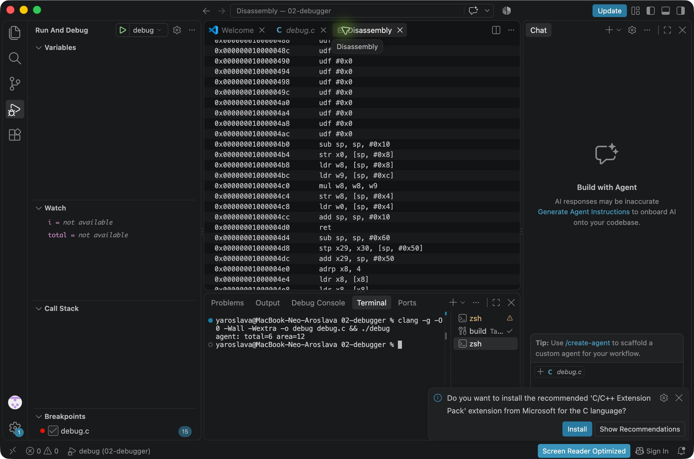
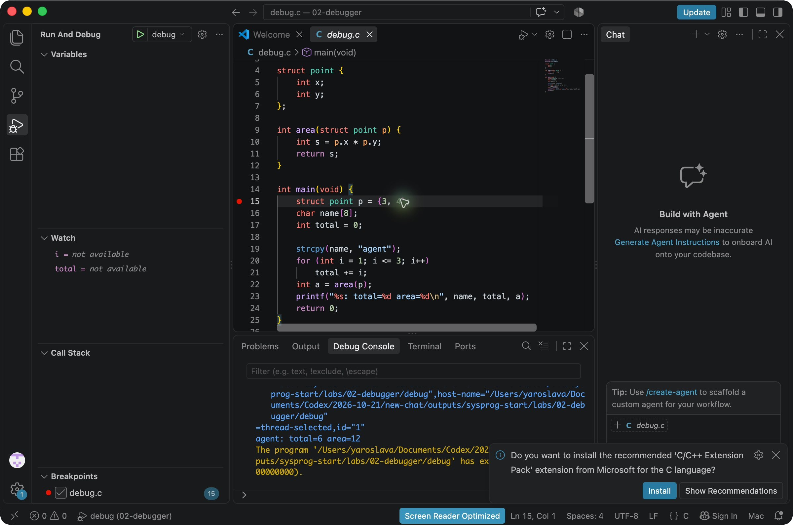
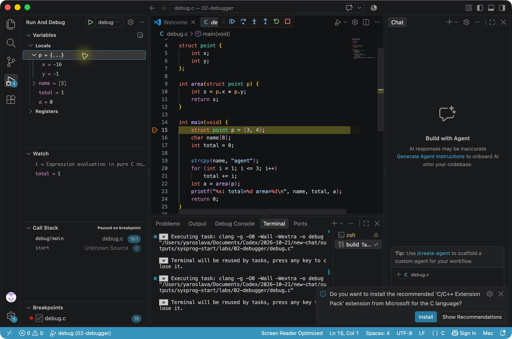
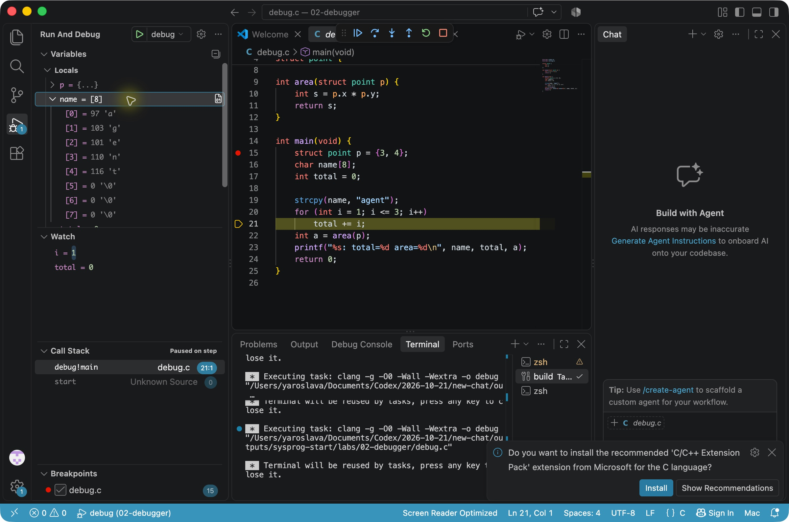
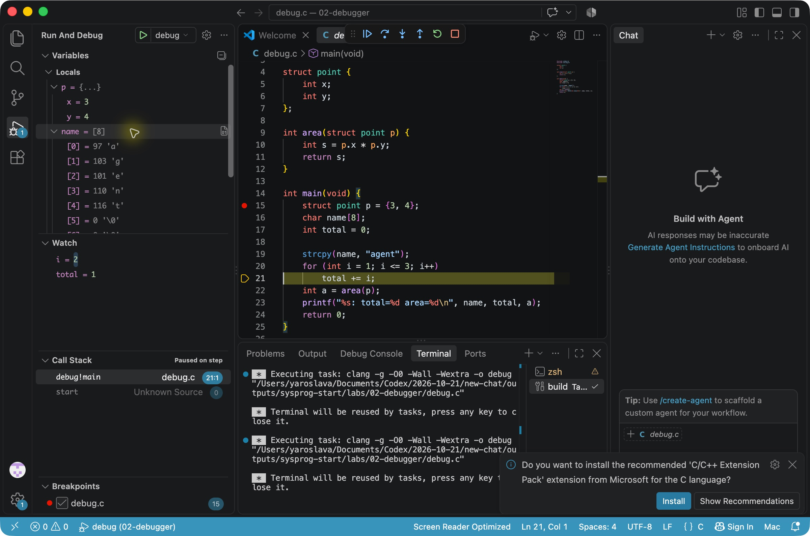
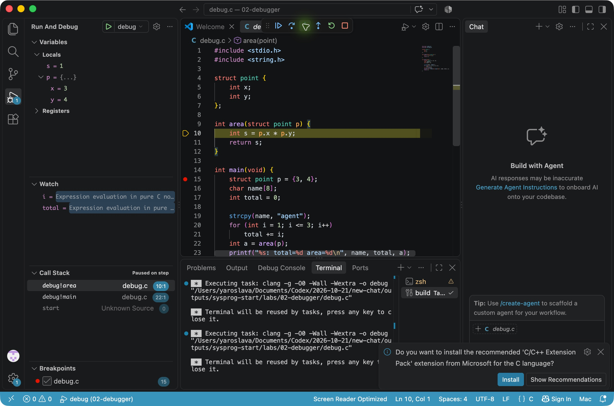
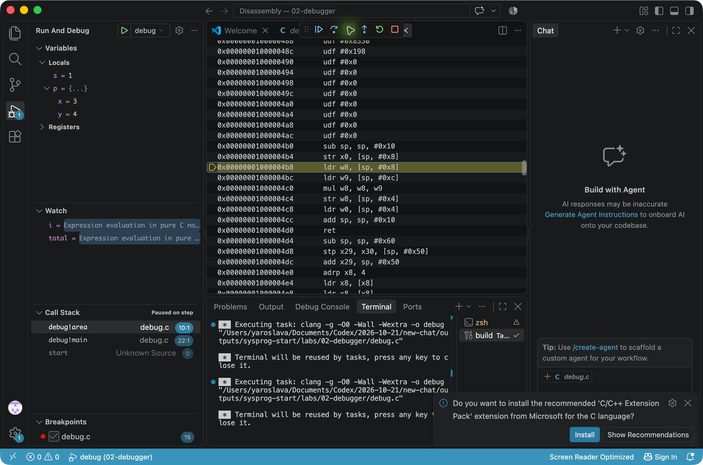
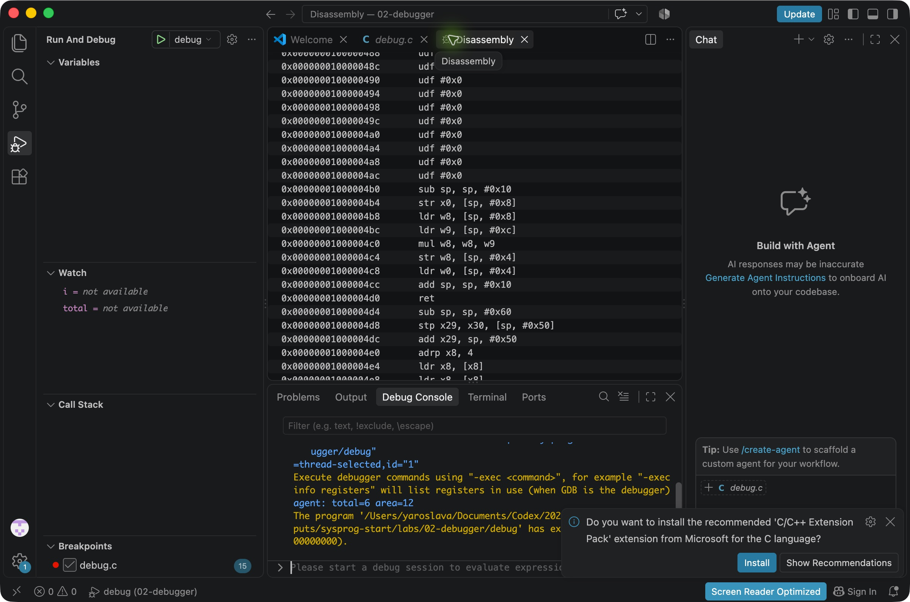

# ЛР 2. Программа в отладчике

Отладчик LLDB в VS Code, macOS ARM64.

1. Без отладчика программа вывела `agent: total=6 area=12`.
2. Точка останова установлена на строке 15.
3. До присваивания отладчик показал `p.x = -16`, `p.y = -1`, `total = 1`. После присваивания `p.x = 3` и `p.y = 4`. Объявление массива на строке 16 не выполняет отдельную команду.
4. После `strcpy` в `name[0]` записан код 97 (буква a). Завершающий ноль находится в `name[5]`.
5. На втором проходе `i = 2` и `total = 1`. После прибавления `total = 3`.
6. В стеке три кадра. Сверху `area`, ниже `main` и системный `start`.
7. Команда умножения `mul w8, w8, w9`. Перед `printf` значения `a = 12` и `total = 6`.
8. Под отладчиком программа вывела `agent: total=6 area=12` и завершилась с кодом 0.

[Открыть PDF](Лабораторная%20работа%202.pdf)

## Снимки

